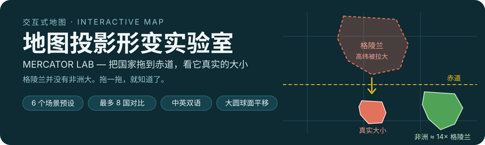
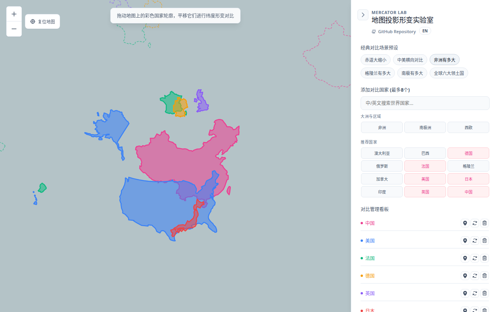

<p align="right"><a href="README.md">中文</a></p>

<p align="center">
  
</p>

<p align="center">
  <a href="https://mercator-country-compare.xiaosang.cc/">▶ Live Demo</a>
  ·
  <a href="https://holynova.github.io/mercator-country-compare/">GitHub Pages Mirror</a>
  ·
  <a href="https://github.com/holynova/mercator-country-compare">GitHub Repository</a>
</p>

Mercator Lab is an interactive map that shows how much Web Mercator inflates each country: drag any country toward the equator and watch it shrink to its true size. Greenland looks as big as Africa on a Mercator map — at the equator, Africa turns out to be about 14× Greenland. Compare up to 8 countries at once, with 6 one-click scenario presets.

## Screenshot

<p align="center">
  
</p>

## Features

- **Spherical translation**: movement follows great-circle routes, so a country shrinks equally along latitude and longitude without stretching — it only changes size, never shape.
- **Multi-country comparison**: add up to 8 countries at once, each independently draggable, locatable and resettable; areas shown in km² in real time.
- **6 scenario presets**: 赤道大缩小 (Equator Shrink), 中美横向对比 (China vs. USA), 非洲有多大 (True Size of Africa), 格陵兰有多大 (Size of Greenland), 南极有多大 (Size of Antarctica), 全球六大领土国 (Six Giants) — one click to load.
- **Virtual regions**: besides every country, you can drag the whole of 非洲 (Africa) or 西欧 (Western Europe) as single shapes.
- **Bilingual**: one-click Chinese/English UI, with country search in both languages.
- **Graticule & equator**: a built-in global graticule grid and highlighted equator line quantify the distortion factor at a glance; outline opacity and grid display are adjustable.
- **4 map styles**: colorful, dark, light, and offline (the offline style renders from local data, no basemap download needed).

## How to Use

1. Type a country name in the search box (Chinese or English), or add one via 「推荐国家」 ("Recommended countries") / 「大洲与区域」 ("Continents & regions").
2. Drag a colored country outline on the map toward the equator and compare its size before and after.
3. Click 「经典对比场景预设」 ("Classic comparison presets") for a ready-made comparison, e.g. China, USA, France, Germany, UK and Japan placed side by side inside Africa.

## Run Locally

```bash
npm install
npm run dev      # dev server
npm run build    # build to docs/ (TypeScript check + Vite bundle)
npm run test     # Vitest unit tests
```

## Tech

- React 19 + TypeScript + Vite; map rendering with MapLibre GL, spherical geometry with d3-geo.
- Country boundary data from world-atlas (110m), parsed with topojson-client; areas and centroids computed by `src/geo.ts`.
- China's outline includes Taiwan (the code merges the Taiwan feature into the China polygon before rendering).

```
src/App.tsx         Main UI: map, sidebar, presets, style switcher
src/countries.ts    Country data: 110m world map + Chinese names + Africa/Western Europe virtual regions
src/geo.ts          Spherical geometry: great-circle translation, area, centroid
src/geo.test.ts     Unit tests for geometry functions
docs/               Prebuilt output (hosted directly on GitHub Pages)
```
