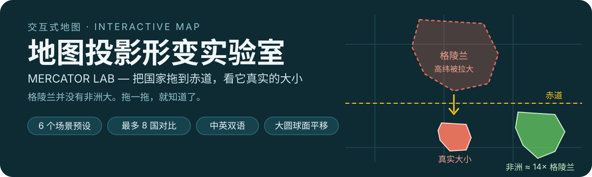
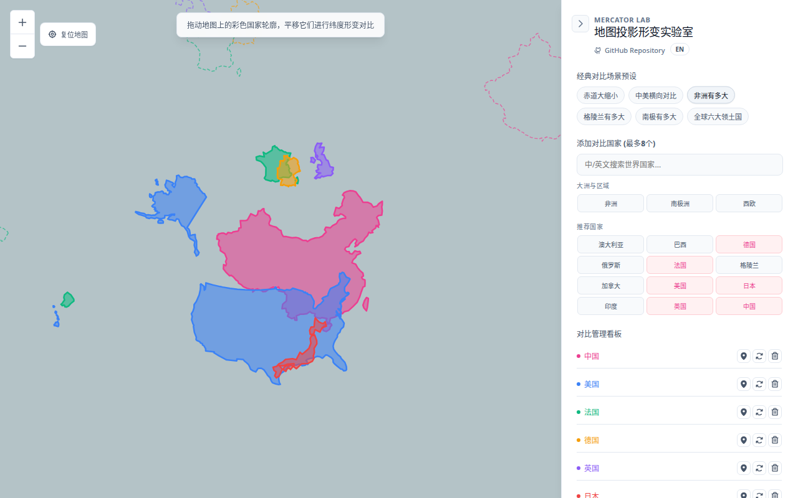

<p align="right"><a href="README.en.md">English</a></p>

<p align="center">
  
</p>

<p align="center">
  <a href="https://mercator-country-compare.xiaosang.cc/">▶ 在线体验</a>
  ·
  <a href="https://holynova.github.io/mercator-country-compare/">GitHub Pages 镜像</a>
  ·
  <a href="https://github.com/holynova/mercator-country-compare">GitHub 仓库</a>
</p>

地图投影形变实验室是一个交互式地图工具：把任意国家拖到赤道附近，直观看到它在 Web Mercator 投影下被拉大了多少。格陵兰在地图上看起来和非洲差不多大，拖到赤道才发现非洲约 14 倍于格陵兰。支持最多 8 个国家同时对比，附 6 个一键场景预设。

## 截图

<p align="center">
  
</p>

## 功能

- **球面平移**：基于大圆航线（Great-Circle）的球面位移计算，拖动国家时经纬双向各向同性收缩，只变大小、不拉伸变形。
- **多国对比**：最多同时添加 8 个国家，每个可独立拖拽、定位、重置；面积以平方公里实时显示。
- **6 个场景预设**：赤道大缩小、中美横向对比、非洲有多大、格陵兰有多大、南极有多大、全球六大领土国，一键加载。
- **虚拟大区**：除全球各国外，还可整体拖动「非洲」「西欧」两个大区做对比。
- **中英双语**：界面一键切换中/英文，国家搜索支持中/英文实时搜索。
- **经纬网与赤道线**：内置全球经纬网辅助网格与高亮赤道线，直观量化形变倍数；轮廓透明度、网格显示可调。
- **4 种地图样式**：彩色、暗黑、明亮、离线（离线样式用本地数据渲染，无需联网加载底图）。

## 玩法

1. 在搜索框输入国家名（中文或英文），或点「推荐国家」「大洲与区域」添加。
2. 拖动地图上的彩色国家轮廓，把它平移到赤道附近，对比前后大小。
3. 点「经典对比场景预设」一键看预设好的对比，如把中、美、法、德、英、日并排放入非洲。

## 本地运行

```bash
npm install
npm run dev      # 开发服务器
npm run build    # 构建到 docs/（TypeScript 检查 + Vite 打包）
npm run test     # Vitest 单元测试
```

## 技术

- React 19 + TypeScript + Vite；地图渲染用 MapLibre GL，球面几何用 d3-geo。
- 国家边界数据来自 world-atlas（110m），经 topojson-client 解析；面积与中心点由 `src/geo.ts` 计算。
- 中国轮廓含台湾地区（代码里把台湾要素合并进中国多边形后渲染）。

```
src/App.tsx         主界面：地图、侧栏、预设、样式切换
src/countries.ts    国家数据：110m 世界地图 + 中文名 + 非洲/西欧虚拟大区
src/geo.ts          球面几何：大圆平移、面积、中心点
src/geo.test.ts     几何函数单元测试
docs/               预构建产物（GitHub Pages 直接托管）
```
